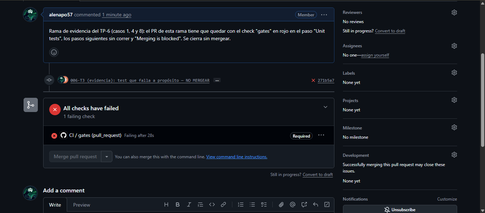
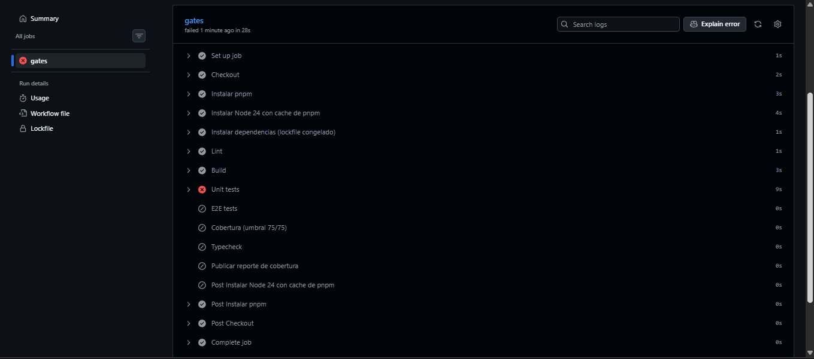

# nestjs-tp — Starter de Spec-Driven Development para los TPs de NestJS

Material de la asignatura **Programación** para desarrollar los Trabajos Prácticos de
backend con NestJS siguiendo la metodología **SDD + multiagentes** de
`/home/dcazabat/Documentos/Cursos/DevelopAI/` (guías `GUIA-OPENCODE.md` y `GUIA-HERMES.md`).

> **Regla de oro:** la IA ejecuta, pero el responsable del proyecto sos vos.
> La spec manda: nada se implementa si no está en la spec aprobada.

---

## Puesta en marcha de la API (TP-1 catálogo Chinook + TP-2 autenticación y roles)

API REST con artistas, álbumes, géneros y pistas, con el mismo contrato que el
servicio FastAPI original (`specs/001-chinook-nest/`), protegida con login y roles
`admin` / `viewer` (`specs/002-auth-roles/`).

**Requisitos:** Node 24 y pnpm. `better-sqlite3` se compila al instalar
(habilitado en `pnpm-workspace.yaml`).

```bash
pnpm install
cp .env.example .env      # completar JWT_SECRET (obligatorio, ≥ 32 caracteres: sin él no arranca)
pnpm start:dev            # o: pnpm build && pnpm start:prod
```

| Qué | Dónde |
|---|---|
| Catálogo | `http://localhost:<PORT>/api/v1/{artists,albums,genres,tracks}` — lecturas públicas |
| Login | `POST /api/v1/auth/token` con `{"username","password"}` → `{"access_token","token_type":"bearer"}` |
| Credencial | header `Authorization: Bearer <access_token>`; vence en `JWT_EXPIRES_MINUTES` (30) |
| Escrituras del catálogo | solo rol `admin` (sin credencial → 401; viewer → 403) |
| Usuarios | `GET /api/v1/users/me` (cualquiera logueado); `GET`, `POST /api/v1/users` y `PATCH /api/v1/users/{id}` (admin) |
| Documentación interactiva | `http://localhost:<PORT>/docs` (botón *Authorize* para la credencial; JSON en `/docs-json`) |
| Listados | `?skip=0&limit=100` (máximo 100) |
| Errores | siempre `{"detail": "<mensaje>"}`; todo 401 trae `WWW-Authenticate: Bearer` |

**Usuarios:** la base trae los de la cátedra (con `IsAdmin` → rol admin). Un admin da de
alta usuarios nuevos con `POST /api/v1/users`; las contraseñas se guardan solo como hash.

**Base de datos:** `data/chinook.template.db` es la copia versionada de Chinook y
nunca se escribe. Al arrancar, si no existe la base de trabajo (`DATABASE_PATH`,
por defecto `data/chinook.db`, fuera del repo), se crea copiándola. Para volver a
los datos originales alcanza con borrar `data/chinook.db`.

**Tests:** `pnpm lint && pnpm build && pnpm test && pnpm test:e2e`. Los e2e
trabajan cada uno sobre una copia temporal de la base (`test/setup-e2e.ts`), así
que no tocan los datos de desarrollo.

## Integración continua (TP-6)

El workflow [`.github/workflows/ci.yml`](../.github/workflows/ci.yml) (en la raíz del
repo) corre el job **`gates`** en cada pull request hacia `main` y en cada push a
`main`, también si el cambio es solo de documentación. Sus pasos, en orden y por
separado, son los mismos comandos que se corren a mano:

| Paso | Comando | Qué valida |
|---|---|---|
| Instalar dependencias | `pnpm install --frozen-lockfile` | Que el lockfile coincida con `package.json` (no lo modifica) |
| Lint | `pnpm lint` | Estilo y reglas del código (sin `any`, sin `@ts-ignore`) |
| Build | `pnpm build` | Que la aplicación compile |
| Unit tests | `pnpm test` | Tests unitarios |
| E2E tests | `pnpm test:e2e` | La API completa, incluido el contrato de todas las operaciones |
| Cobertura | `pnpm test:cov` | Líneas y ramas ≥ 75% sobre todo `src/` (spec 005) |
| Typecheck | `pnpm typecheck` | Tipos de `src/` y `test/` |

**Cómo leer un fallo:** en el PR, "Details" al lado de `gates` muestra la lista de
pasos; el que falló está en rojo y los siguientes no corren. Si llegó a correr la
cobertura, su reporte queda como artefacto `cobertura` de la corrida.

**La rama `main` está protegida:** exige el check `gates` en verde, exige pull request
y no admite excepciones, tampoco para administradores. Todo cambio entra por una rama
y un PR. El workflow tiene permisos de solo lectura, usa el evento `pull_request` (un
PR desde un fork corre sin secretos) y no necesita ningún secreto: los tests usan
valores de prueba propios.

**Evidencia del bloqueo:** el [PR #1](https://github.com/SoftwareSegundo2026/Alexis-Napoli-Programacion/pull/1)
agrega un test que falla a propósito. Su
[corrida](https://github.com/SoftwareSegundo2026/Alexis-Napoli-Programacion/actions/runs/43891474309)
falla en "Unit tests", los pasos siguientes no corren y el merge queda deshabilitado
aun siendo administrador. Se cerró sin mergear.





Configuración de la regla:
[PR obligatorio](docs/evidencias/006-regla-1-pull-request.png) ·
[check `gates` requerido](docs/evidencias/006-regla-2-check-gates.png) ·
[sin excepciones](docs/evidencias/006-regla-3-sin-bypass.png) ·
[permisos del token](docs/evidencias/006-permisos-token.png).
Detalle completo en [`specs/006-ci/validate.md`](specs/006-ci/validate.md).

## Docker, despliegue continuo y observabilidad (TP-7)

Spec: [`specs/007-docker-cd/`](specs/007-docker-cd/spec.md). La misma imagen corre en
cualquier máquina: lo único que cambia entre entornos es el `.env`.

### Levantar la API en una máquina limpia (un solo comando)

Solo hace falta **Docker con el plugin compose**: ni Node ni pnpm. Hay dos caminos.

**A. Desde el código, sin credenciales (recomendado para probarla):**

```bash
git clone https://github.com/SoftwareSegundo2026/Alexis-Napoli-Programacion.git
cd Alexis-Napoli-Programacion/nestjs-tp
cp .env.example .env                  # completar JWT_SECRET (≥ 32 caracteres)
docker compose up -d --build --wait   # construye la imagen (con los gates) y espera healthy
curl http://localhost:3300/health     # {"status":"ok","database":"up"}
```

La primera vez tarda unos minutos, porque dentro de la imagen se compila y corren todos los
tests. Este mismo camino se prueba en cada corrida del workflow (paso "Un solo comando desde
el código").

**B. Con la imagen ya publicada en `ghcr.io`, la misma que se probó en el pipeline:**

El paquete es **privado**: la organización de GitHub no permite paquetes públicos. Para
bajarlo hay que identificarse **una vez** con una cuenta que tenga acceso, ya sea un miembro
de la organización o alguien con acceso al repo, porque el paquete hereda los accesos del
repo:

```bash
# Token: GitHub → Settings → Developer settings → Personal access tokens (classic),
# con el permiso read:packages. Se pega como contraseña.
docker login ghcr.io -u <usuario-de-github>
cp .env.example .env                  # completar JWT_SECRET
docker compose up -d --wait           # baja la imagen latest (o IMAGE_TAG=<sha>) y espera healthy
```

Sin el `docker login`, este camino responde `denied`.

| Variable (`.env`) | Para qué | Por defecto |
|---|---|---|
| `JWT_SECRET` | Firma de credenciales. **Obligatoria**; sin ella no arranca | — |
| `LOG_LEVEL` | `fatal`, `error`, `warn`, `log`, `debug` o `verbose` | `log` |
| `JWT_EXPIRES_MINUTES`, `PASSWORD_HASH_ROUNDS` | Como en el TP-2 | 30, 12 |
| `API_PORT` | Puerto del host (el contenedor siempre escucha en 3000) | 3300 |
| `IMAGE_TAG` | Versión de la imagen: el sha de un commit de `main` | `latest` |

Una variable mal configurada (por ejemplo `LOG_LEVEL=loud`) impide arrancar, con un mensaje
que nombra la variable. La base vive en el volumen `chinook-data`: sobrevive a reinicios y
redespliegues.

### La imagen

[`Dockerfile`](Dockerfile) en tres etapas:
1. **build:** instala, compila y corre `lint`, `build`, `test` y `test:e2e`. Si un gate falla,
   no hay imagen.
2. **prod-deps:** instala solo las dependencias de producción.
3. **runtime:** la que se publica.
   - Node 24.14.1 slim, fijado por digest.
   - Corre con el usuario `node`, no root.
   - No trae npm, pnpm ni TypeScript.
   - No trae ningún `.env`: el [`.dockerignore`](.dockerignore) los deja afuera.
   - Tiene un `HEALTHCHECK` contra `/health`.

`GET /health` es público, está fuera de `/api/v1` y consulta el archivo de la base. Responde
200 `{"status":"ok","database":"up"}` o 503 `{"status":"error","database":"down","detail":…}`.
Con 503, el contenedor queda `unhealthy`.

### Pipeline: [`.github/workflows/docker.yml`](../.github/workflows/docker.yml)

| Job | Cuándo | Qué hace |
|---|---|---|
| `image` | Cada PR y cada push a `main` | Construye la imagen 2 veces sin caché (con los gates adentro), compara su contenido y corre [`deploy/smoke-test.sh`](deploy/smoke-test.sh) con el runner como servidor |
| `publish` | Push a `main` | Sube a `ghcr.io` **la misma imagen probada**, con el sha del commit y `latest` (token de la corrida, sin credenciales en el repo) |
| `deploy` | Después de `publish`, o a mano | Copia el compose y ejecuta [`deploy/deploy.sh <sha>`](deploy/deploy.sh) por SSH; espera `healthy` y, si no llega, la corrida queda en rojo |

Sin los secrets del servidor, `deploy` se saltea con un aviso y la corrida queda verde. El check
requerido de `main` sigue siendo `gates` (`ci.yml`).

**Evidencia:**
- [Corrida en `main`](https://github.com/SoftwareSegundo2026/Alexis-Napoli-Programacion/actions/runs/43919954077):
  la imagen se publicó en `ghcr.io` y `deploy` se salteó con el aviso, porque no hay servidor.
- [Corrida del PR](https://github.com/SoftwareSegundo2026/Alexis-Napoli-Programacion/actions/runs/43915953632),
  con extracto en [`docs/evidencias/007-docker-image-pr.txt`](docs/evidencias/007-docker-image-pr.txt):
  - Las dos imágenes son idénticas (23.456 archivos comparados).
  - Corre sin root y sin toolchain.
  - Ningún secreto en la imagen ni en `docker history`.
  - Despliegue y rollback quedan `healthy`.
  - Vuelve sola tras reiniciar el daemon de Docker.
  - Apagado ordenado con código 0.
  - Con la base rota, nunca queda `healthy`.

### Preparar un servidor (una sola vez)

1. Instalar Docker con el plugin compose y crear un usuario de despliegue que pueda usar
   Docker (grupo `docker`).
2. Crear la carpeta `~/chinook` de ese usuario y poner adentro el `.env` de producción. El
   `.env` nunca sale del repo ni de la imagen.
3. Cargar en GitHub (*Settings → Secrets and variables → Actions*) estos secrets:
   - `DEPLOY_HOST`: dirección del servidor.
   - `DEPLOY_USER`: el usuario de despliegue.
   - `DEPLOY_SSH_KEY`: su clave privada.
   - `DEPLOY_KNOWN_HOSTS`: la huella del servidor, que se obtiene con `ssh-keyscan -H <host>`.
     Sin ella, el SSH no se conecta, para no desplegar en un impostor.
4. El paquete de `ghcr.io` es privado (política de la organización). En el servidor, correr
   **una vez** `docker login ghcr.io` con un token de solo lectura (`read:packages`): Docker
   guarda la credencial y `deploy.sh` ya puede bajar cada versión.

A partir de ahí, **cada merge a `main` se despliega solo**.

### Rollback

Volver a una versión anterior es desplegar el sha de una imagen ya publicada; no se
reconstruye nada:
- **Desde GitHub:** *Actions → Docker → Run workflow* con `tag` = sha anterior.
- **En el servidor:** `cd ~/chinook && ./deploy.sh <sha anterior>`.

Los tags publicados se ven en la página del paquete en GitHub (*Packages*).

### "¿Qué pasó en producción a las 3 AM?"

Cada evento es **una línea JSON**, con `timestamp` (UTC), `level`, `message` y `context`.
Lo que pasa dentro de un pedido lleva además su `requestId`.
- **Cada pedido** deja una línea con método, ruta (sin la query), estado y duración. El nivel
  es `log` (2xx/3xx), `warn` (4xx) o `error` (5xx).
- **Un error 500** deja además el detalle técnico con el mismo `requestId`.
- **El cliente recibe ese id** en el header `X-Request-Id`, y si lo manda, se respeta.
- **Nunca se registran** cuerpos, headers ni query strings. Contraseñas, tokens y otros campos
  sensibles se tapan como `[REDACTED]`.

```bash
cd ~/chinook
# Errores de esa hora (los timestamps están en UTC)
docker compose logs --no-log-prefix --since 2026-11-16T06:00:00Z --until 2026-11-16T07:00:00Z api \
  | jq -c 'select(.level == "error" or .level == "fatal")'
# Todo lo de un pedido, a partir del requestId de la línea anterior o del cliente
docker compose logs --no-log-prefix api | jq -c 'select(.requestId == "<id>")'
# ¿Se reinició o se apagó? Apagados ordenados, arranques fallidos y cantidad de reinicios
docker compose logs --no-log-prefix api | jq -c 'select(.context == "Shutdown" or .level == "fatal")'
docker inspect --format '{{.RestartCount}} reinicios · {{.State.Health.Status}}' "$(docker compose ps -q api)"
```

La telemetría de NestJS Observe sigue siendo opcional: solo se activa con `OBSERVE_APP_KEY`
y `OBSERVE_APP_SECRET` en el `.env`.

---

## Cómo arrancar

Este repo es un **arnés**, no una app. Se superpone sobre un proyecto NestJS:

```bash
# 1. Base de código (o crear desde cero con `nest new`)
cp -r ../nestjs-music ~/mi-tp

# 2. Copiar el arnés SDD encima
cp -r nestjs-tp/. ~/mi-tp/          # AGENTS.md, MEMORY.md, docs/, .opencode/, .agents/

# 3. Abrir OpenCode dentro del proyecto
cd ~/mi-tp && opencode
```

Verificación mínima de que el arnés quedó bien: `/skills` muestra `sdd` y
`nestjs-esm`, `/agents` muestra `coordinator`, `planner`, `implementer` y
`reviewer`, y `pnpm test` corre.

---

## Qué hay en esta carpeta

| Ruta | Qué es | Quién lo usa |
|---|---|---|
| `AGENTS.md` | Instrucciones del proyecto (stack, comandos, límites). Máx. 40 líneas. | Agente (siempre) |
| `MEMORY.md` | Memoria entre sesiones: estado, decisiones, próximos pasos. | Agente, tras cada tarea |
| `docs/constitution.md` | 6 principios innegociables. Toda spec/plan/tarea debe cumplirlos. | Planner y reviewer |
| `.opencode/agents/` | Los 4 agentes: `coordinator`, `planner`, `implementer`, `reviewer`. | Coordinación |
| `.opencode/commands/` | Comandos `/sdd-*` que automatizan el flujo. | Alumno / docente |
| `.agents/skills/` | Skills `sdd` (el flujo) y `nestjs-esm` (trampas del stack). | Agente, al cargarlas |
| `specs/000-ejemplo-chinook/` | Spec, plan y tareas **de referencia** ya resueltos. | Modelo a imitar |
| `consignas/` | Consignas TP-1 a TP-8 + índice con recorrido sugerido. | Alumno |
| `rubrica/` | Rúbrica de entrega + comando de validación para el docente. | Docente |

---

## El flujo, en una línea

```
/sdd-constitution → /sdd-spec → /sdd-clarify → /sdd-plan → /sdd-tasks
                                                            ↓
              /sdd-validate ← /sdd-implement T1, T2, T3… (una tarea por vez)
```

**Nunca** se pasa a la fase siguiente sin la aprobación explícita del usuario.
Cada fase deja un artefacto en disco (`specs/NNN-*`), que es lo que se evalúa.

---

## Adaptaciones a NestJS (importante)

La guía DevelopAI de referencia está pensada en JS puro con `node --test`. En este
TP se reemplaza el gate por el del repo:

| En la guía | Acá |
|---|---|
| `node --test` | `pnpm test` (unit) + `pnpm test:e2e` (e2e con supertest) |
| Sin linter | `pnpm lint` (oxlint type-aware) + `pnpm format` (prettier) |
| Sin build | `pnpm build` debe pasar antes de cerrar una tarea |

Todo eso ya está reflejado en `AGENTS.md`, `docs/constitution.md`, la skill `sdd`
y los comandos `/sdd-implement` y `/sdd-validate`.

---

## Entregables por TP

1. `specs/NNN-<nombre>/spec.md` — QUÉ y POR QUÉ (HU + requisitos en EARS), aprobada.
2. `specs/NNN-<nombre>/plan.md` — CÓMO (archivos, capas, estrategia de tests).
3. `specs/NNN-<nombre>/tasks.md` — tareas de 20-30 min con **"Hecho cuando:"**.
4. Historial git: **un commit por tarea** marcada en `tasks.md`.
5. `MEMORY.md` actualizado al cierre de cada tarea.
6. Suite en verde: `pnpm lint && pnpm build && pnpm test && pnpm test:e2e` (y, desde el
   TP-5/TP-6, `pnpm test:cov` y `pnpm typecheck`; en GitHub los corre el job `gates`).

Ver detalles y pesos en [`rubrica/rubrica-entrega.md`](rubrica/rubrica-entrega.md).
